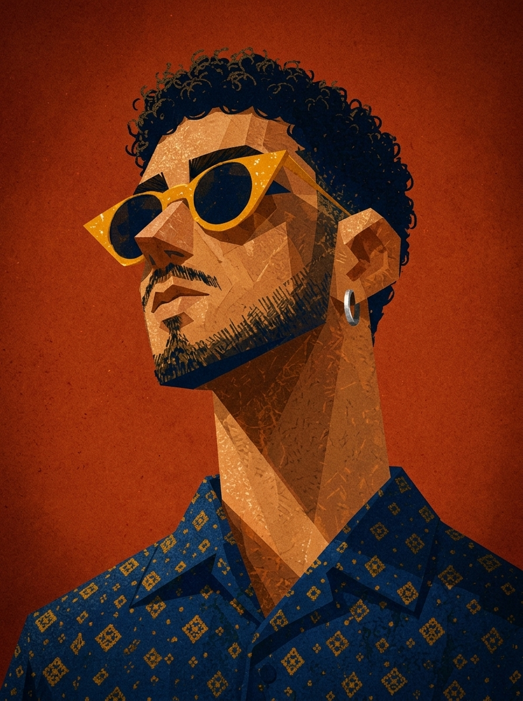

  
  &nbsp;&nbsp;&nbsp;
  

<h2 align="center">KVASIR &nbsp;×&nbsp; KYOKA</h2>

<em>iki arkadaş arasında günlük bir motivasyon mektubu.</em>

---

**warinstinct**, derin bir teknik temeli olmayan, bilerek basit tutulmuş bir alandır.

Amacı; gündelik hayatın içinden süzülen yorumları her gün üretilen bir yapay zekâ görseline ve tek bir cümleye dönüştürerek birbirimize motivasyon sağlamak, sanatsal bakışımızı diri tutmaktır.

**Kyoka** ve **Kvasir**, iki arkadaşın oluşturduğu iki personadır. Dışarıdan bakıldığında birer alter ego gibi görünseler de, aslında aynı yolda yürürken birbirine yön hatırlatan iki yansıma, iki işarettir. Her gün bırakılan görsel ve cümle, karşı tarafa uzatılmış sessiz bir nottur.

Her paylaşım yalnızca bırakıldığı günün sonuna kadar orada kalır; ertesi gün yerini yeni bir boşluğa bırakır. Haftanın sonunda, yedi günün izleri kısa bir anlığına bir araya gelir ve sonra yeniden akışa karışır.

Burası bitmiş bir ürün değil — gün geçtikçe birlikte geliştirerek hem sanatsal dilimizi hem de bu ortak alanın boyutsal kazanımını büyütmeyi amaçlayan yaşayan bir defterdir.
